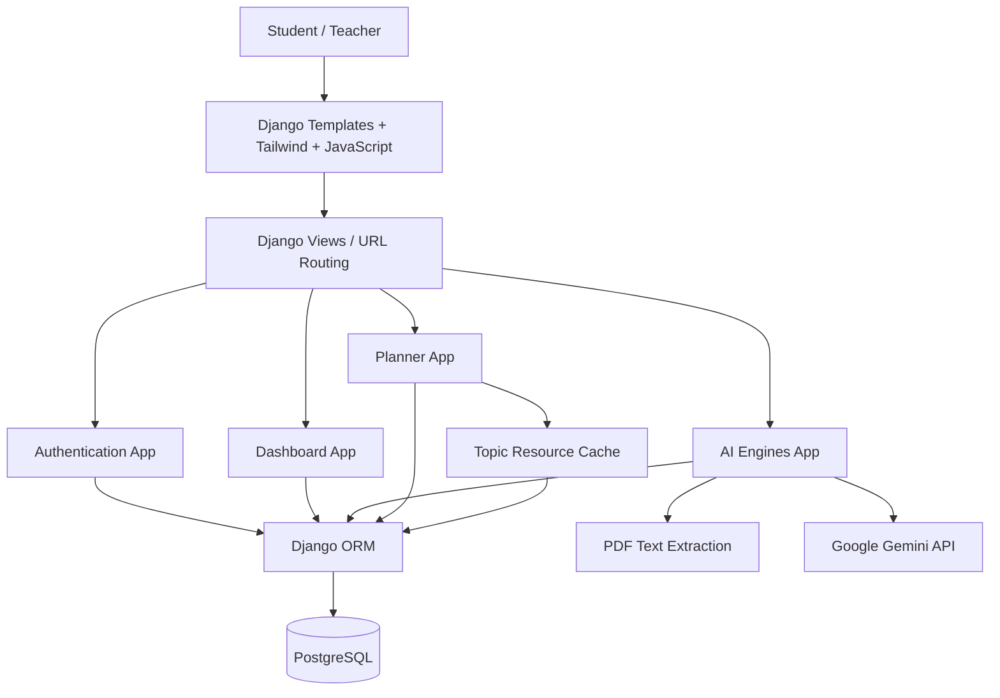
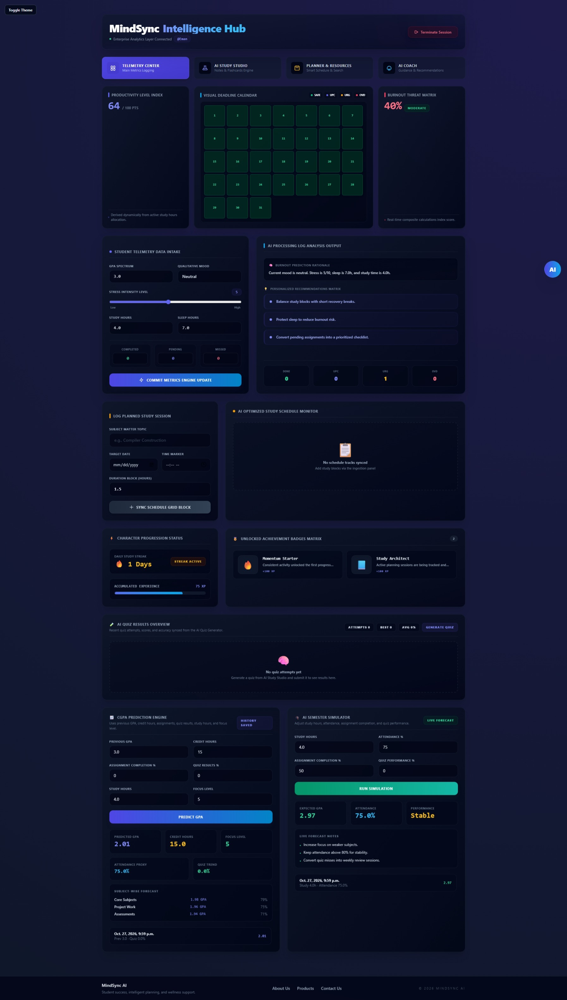
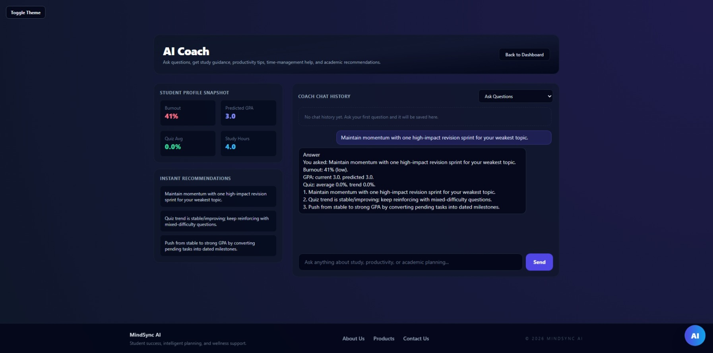
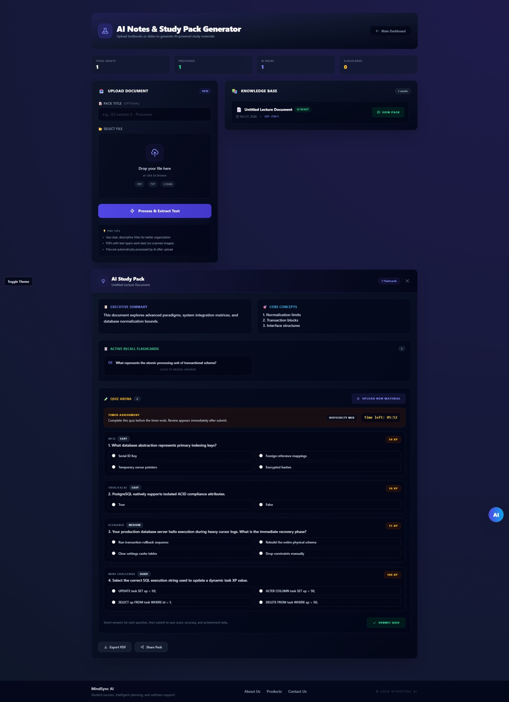
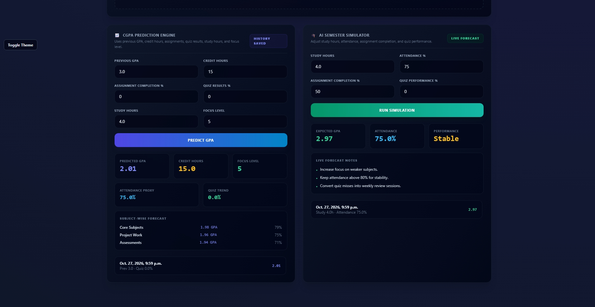
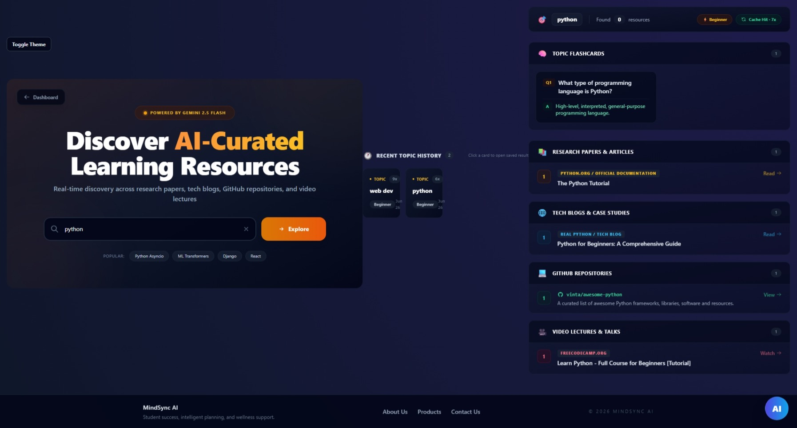
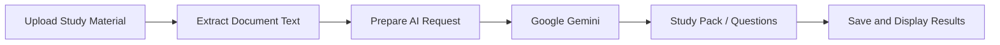

# MindSync AI

**AI-powered student success, study planning, and learning assistance platform**

MindSync AI is a full-stack Django application that brings academic progress tracking, study planning, AI-assisted learning, and resource discovery into one workspace. Students can upload learning material, generate study packs, review quiz results, plan study sessions, and track academic and wellness-related indicators. Teacher-facing views support academic oversight.
> **Status:** Academic project / portfolio demonstration. Features described below are based on project documentation; deployment, test coverage, and AI output quality have not been independently verified.

## Highlights

- AI-assisted study packs: Upload documents, extract text, and generate summaries, key concepts, flashcards, and study questions using Google Gemini.
- AI study coach: Conversational learning assistance with saved conversation history.
- Academic dashboard: Track GPA-related data, study activity, and self-reported academic/wellness telemetry.
- CGPA forecasting: Explore academic projections and semester simulations (not a trained predictive ML model).
- Study planning: Create and manage planned study sessions and completion status.
- Resource discovery: Search for topic-based learning resources with cached results.
- Role-aware experience: Student and teacher profiles, authentication, and tailored views.
## Tech Stack

| Layer | Technology |
|---|---|
| Backend | Python, Django 6.x |
| Frontend | HTML5, CSS3, JavaScript, Tailwind CSS, Django templates |
| Database | PostgreSQL, Django ORM |
| Generative AI | Google Gemini via `google-genai` |
| Document processing | `pypdf` |
| Validation / supporting libraries | Pydantic, HTTPX |
| Development | Git, GitHub, VS Code |


## Architecture


The project uses separate Django apps for authentication, dashboards, AI features, and planning. Gemini is accessed from application logic; PostgreSQL stores application records and generated results.

## Application Screenshots

Explore the MindSync AI interface through screenshots captured from the running application.

### Student Dashboard


### AI Study Coach


### AI Study Pack Generator


### CGPA Prediction


### Resource Discovery


> A separate study planner screenshot is not included because it has not been captured. The planner remains described in the features section.

## Core Modules

### Authentication (`apps/authentication`)

- Registration, login, and logout
- Custom user model with student/teacher role flags
- Student and teacher profiles
### Dashboard (`apps/dashboard`)

- Academic and wellness-related telemetry
- Planned study sessions and completion tracking
- CGPA prediction history and semester simulation snapshots
- Student and teacher dashboard views
### AI Engines (`apps/ai_engines`)

- Uploaded study materials and extracted document text
- Generated study packs: summaries, key concepts, flashcards, and questions
- Quiz attempt results
- AI coach conversations and recommendations
### Planner (`apps/planner`)

- Topic-based resource discovery
- Reusable cached search results
## Data Model Overview

The documented database includes:

| Model/table | Purpose |
|---|---|
| `authentication_user` | Custom users and roles |
| `student_profile`, `teacher_profile` | Role-specific profiles |
| `dashboard_completestudenttelemetry` | Academic and wellness telemetry |
| `dashboard_plannedstudysession` | Study schedules and completion |
| `dashboard_cgpapredictionhistory` | CGPA forecast history |
| `dashboard_semestersimulationhistory` | Semester simulations |
| `ai_engines_uploadedmaterial` | Upload metadata and extracted text |
| `ai_engines_generatedstudypack` | Generated study resources |
| `ai_engines_quizresult` | Quiz outcomes |
| `ai_engines_aicoachconversation` | Coach interaction history |
| `planner_topicresourcecache` | Cached resource discovery |


These names come from the project documentation; consult Django models and migrations for the definitive schema.
## Local Setup

### Prerequisites
- Python version compatible with Django 6.x (Python 3.12+)
- PostgreSQL
- Node.js only if rebuilding frontend assets requires it
- A Google Gemini API key for AI features
### 1. Clone

```text
git clone https://github.com/EmanZahid1644/MindSync.git
cd MindSync
```

### 2. Create a virtual environment

**Windows (Command Prompt):**

```text
python -m venv .venv
.venv\Scripts\activate
```

**macOS/Linux:**

```text
python3 -m venv .venv
source .venv/bin/activate
```

### 3. Install dependencies

```text
python -m pip install -r requirements.txt
```

### 4. Configure the application

Configure the PostgreSQL connection, Django secret key, allowed hosts, and Gemini API credentials according to `mindsync_core/settings.py` and the relevant AI service code. Create local environment configuration as required by the implementation.

> Do not commit API keys, database passwords, Django secret keys, or uploaded private documents. The exact environment-variable names should be copied from the source configuration rather than guessed.

### 5. Apply migrations and run

```text
python manage.py migrate
python manage.py runserver 8001
```

Visit `http://127.0.0.1:8001/dashboard/home/` (login may be required). Port 8001 is used here to avoid conflicts with another application running on port 8000. The root path `/` is not necessarily configured in this project.

> **Setup note:** The local project directory contains `mindsync_core`, `mindsync_root`, and `apps`. If the checked-out GitHub branch differs, confirm `manage.py`, settings module, migrations, and dependencies before running these commands.

## AI Workflow


Generated study materials are assistance tools, not guaranteed authoritative sources. Users should verify factual content against the original documents.
## Quality, Security & Engineering Considerations

- Django authentication and role-specific views form the access-control foundation; review object-level permissions before production deployment.
- Validate file type, size, and extracted content for uploaded documents.
- Keep Gemini credentials server-side and avoid exposing private uploaded content unnecessarily.
- Add automated tests for authentication, upload handling, AI failure paths, and role separation.
- Evaluate generated summaries and quizzes for factual grounding and usefulness.
- Measure generation latency, API costs, and caching effectiveness before making performance claims.
> No passing test count or deployment uptime is claimed here, because those have not yet been verified for this repository.

## Known Limitations
- Browser-based application; no native mobile client or offline sync.
- LLM output may be incomplete or inaccurate.
- CGPA forecasts and semester simulations should not be represented as trained ML predictions without evidence of a trained model.
- Production-grade monitoring, load testing, and broader automated testing are not documented.
- Teacher access and privacy controls should be audited before use with real student records
Project Focus
Full-stack Python development · Django architecture · PostgreSQL · Generative AI integration · Document processing · Academic analytics · Study planning
License
No open-source license is currently included. All rights reserved unless a license is added by the repository owner.
